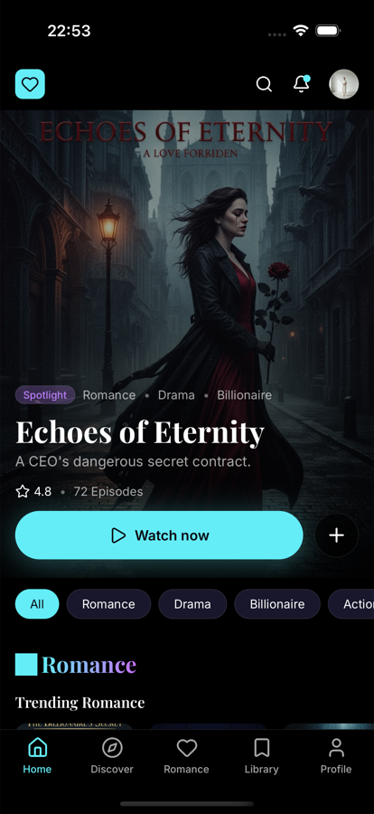
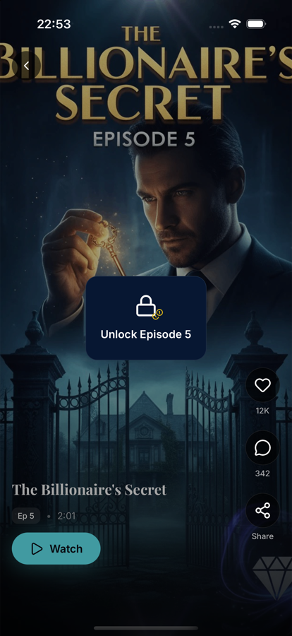
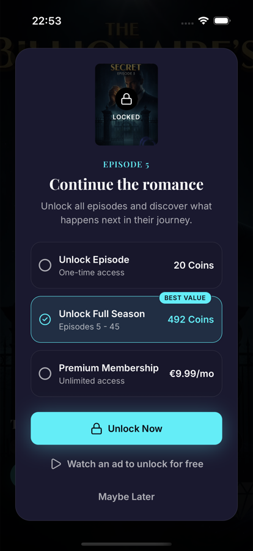
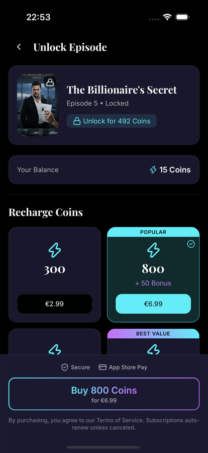
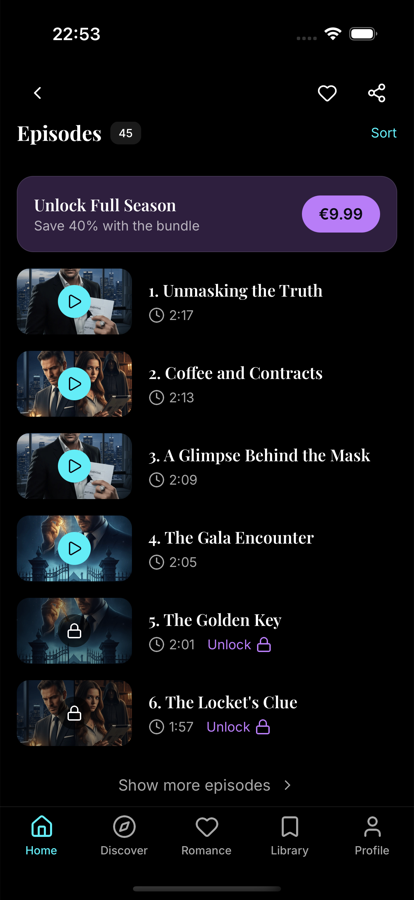

# LoveFlix

A clickable mock-up of a short-form vertical romance drama app, built from the Figma design with Expo and React Native. All data is mocked, and every payment is simulated.

| Home                               | Player and lock                        | Unlock card                                 | Coin store                                | Series detail                                 |
| ---------------------------------- | -------------------------------------- | ------------------------------------------- | ----------------------------------------- | --------------------------------------------- |
|  |  |  |  |  |

## Try this path

The demo starts with 15 coins. Episodes 1–4 are free and every later episode costs 20 coins, so the first unlock fails on purpose.

1. On Home, tap a poster such as **The Billionaire's Secret** to open Series detail.
2. Tap **Play Ep 1**. Each episode moves on to the next one when it ends. Swipe up to skip ahead, and episode 5 stops on the lock.
3. Tap **Unlock Episode 5** to open the card, keep a coin option selected and tap **Unlock Now**. You don't have enough coins, so the coin store opens.
4. Tap **Buy** on the pack that's already selected. The unlock completes and the episode starts playing.
5. Try the other paths on another locked episode: **Watch an ad** (a 5-second countdown) or **Premium Membership**.
6. On Series detail, the **€9.99** pill buys the whole season.
7. **Profile → Reset demo** returns the app to its first-launch state.

## Run it

You need Node 22 (the version this was built with), and Xcode for iOS or Android Studio for Android. The app does not run in Expo Go, because MMKV needs native code. It runs as a development or release build.

```bash
npm install
```

```bash
LANG=en_US.UTF-8 LC_ALL=en_US.UTF-8 npx expo run:ios --device "iPhone 17 Pro"
```

```bash
npx expo run:android
```

`run:ios` and `run:android` build the app, install it and start the dev server. To reopen an installed development build later, run `npx expo start --dev-client`.

The text follows the device language: English by default, German on a German device.

To run the type check, lint, format check and tests in one go:

```bash
npm run check
```

## Stack

Expo SDK 58, React Native 0.88 (New Architecture), React 19 with the React Compiler, and strict TypeScript.

| Concern      | Choice                                                   |
| ------------ | -------------------------------------------------------- |
| Navigation   | expo-router with typed routes                            |
| Video        | expo-video                                               |
| Server state | TanStack Query over a mock repository                    |
| Client state | jotai, saved with MMKV                                   |
| Lists        | FlashList v2                                             |
| Motion       | Reanimated 4, Gesture Handler 3, expo-haptics            |
| Text         | i18next (English and German), Playfair Display and Inter |
| Tests        | Jest and React Native Testing Library                    |

## Architecture

```
src/
  app/          routes only; each one renders a screen
  screens/      one file per screen: data hooks plus an ordered list of sections
  features/     sections, hooks and utils for home, player, unlock, store, ad, series, navigation
  components/ui shared design system
  domain/       models and pure business rules, with no imports from the rest of the app
  data/         repository interfaces, mock implementations, query hooks and fixtures
  state/        jotai atoms: saved values, read-only values and write actions
  theme/        a raw palette behind semantic color, type and spacing tokens
  config/       demo.ts: prices, free episodes, starting balance
  locales/      en.json, de.json
```

Dependencies point one way: `app → screens → features → (components/ui, domain, state, data)`.

## Decisions worth a look

- **Business rules are pure functions.** Lock rules, pricing and season bundles live in `src/domain`, so they can be tested without React.
- **Repositories hide the mock data.** Features only see interfaces, and mock implementations add latency and can simulate failures. A real API would plug in at `RepositoryProvider`.
- **One video player at a time.** The player is a paged FlashList, and only the active, unlocked slide mounts a `VideoView`, so memory stays flat however long the feed is.
- **Home is its own stack.** The tab bar stays visible on Series detail with no special handling. The player, unlock card, store and ad sit above the tabs.
- **Every data-driven screen has loading, error and empty states.** In a development build, long-press the logo on Home to open the design system catalogue, which has a switch for simulating network errors.
- **Lint enforces the rules that matter.** No `any`, no deep theme imports, no mock imports from features, no `console`.

## Known limitations

- **One user per device.** Coins, unlocks, membership and My List are saved on the device, are not tied to a user and are never cleared by a logout, because there is no sign-in in this scope. In a real app they would be owned by the server: React Query data keyed by user id, changed through mutations, with a per-user MMKV cache. Logging out would clear the query cache and create a new jotai store.
- **Placeholder video.** Three 15-second silent clips made from the design's episode artwork are bundled with the app, so the demo needs no network. Every series cycles through the same three, so an episode's clip may not match its series. Episode lengths in the UI, such as 2:13, are mock data and don't match the clips. The 60-second playback cap in `config/demo.ts` is only reached with longer videos.
- **Two prices for one season.** Series detail sells the season for €9.99, as in the design, and the unlock card sells it for coins. A real product would settle on one.
- **Some content stays in English on a German device.** Series titles, synopses, tags, rail titles and episode titles are mock data, which an API would localise.
- **Not built:** sign-in, search, notifications, comments, sharing, and the Library, Discover and Romance tabs, which are placeholders. Cast members show initials because the mock data has no photos.
- **Payments are simulated.** No store SDK is involved.

## Tests

Tests sit in `__tests__/` next to the code and query by role, label and text. They cover domain rules and atoms, with coverage thresholds of 90% on domain, repositories, queries and state, plus hooks, key components and full-screen flows for the unlock card, store, ad, Home and Series detail. There are no end-to-end or snapshot tests.
